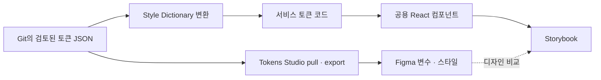

# Storybook과 Figma 동기화 검토

코드와 Storybook은 같은 컴포넌트·토큰을 참조하도록 연결했다. 이번 범위는 실제 컴포넌트의 예시와 Figma 비교 링크다. 토큰 자동 변환과 Figma 수정은 포함하지 않았다.

## 이번에 적용한 범위

`client/.storybook`에 React·Webpack용 Storybook 설정을 추가했다. 서비스의 Webpack 설정을 통째로 가져오지 않고 별도 SWC 컴파일러를 사용한다. 서비스 진입점의 지도 SDK·분석·PWA 초기화는 실행하지 않는다.

`client/stories`의 스토리는 `src/shared/components/ui`에 있는 실제 컴포넌트를 가져온다. Button·ToggleButton·Chip·Notice·Modal·BottomSheet·Spinner와 Row·Stack을 등록했다. ToggleButton·Chip·BottomSheet는 상호작용 결과를 Storybook args에 반영한다. Modal은 열기 버튼을 누르면 나타난다.

색상 스토리는 `palette.ts`와 `color.ts`를 순회한다. 타이포그래피 스토리는 `font.ts`와 `typography.ts`를 순회한다. 표시할 값을 스토리에 따로 복사하지 않으므로 기존 토큰의 값이나 항목이 바뀌면 목록에도 반영된다.

컴포넌트의 고정된 variant·size·snap 목록은 스토리에 명시한다. 공개 prop이 변경되면 해당 예시와 Controls 목록도 검토해야 한다. 타입 검사가 모든 선택지의 누락까지 찾아주지는 않는다.

`@storybook/addon-designs`의 Design 패널에 기존 Figma 링크를 연결했다. 링크는 `client/stories/figma.ts`에서 구성하고 각 스토리의 `parameters.design`에 지정한다. Chip·ToggleButton은 선택 상태별 시안을 연결한다. Spinner와 색상·타이포그래피도 해당 시안을 연결한다. Row·Stack은 대응하는 시안이 없어 링크를 추가하지 않았다.

링크는 좌표가 아니라 노드 ID를 가리킨다. 같은 노드의 위치·이름·스타일을 수정하면 링크를 유지할 수 있고, Design 패널은 최신 Figma 디자인을 표시한다. 노드를 삭제하고 다시 만들거나 다른 파일로 교체하면 링크도 갱신해야 한다. 해당 Figma 파일을 볼 수 있는 계정으로 로그인해야 디자인을 확인할 수 있다.

Client CI에는 PR에서만 실행되는 `Storybook build` job을 추가했다. 기존 `Client checks`와 병렬로 실행하며, 앱 빌드·CD는 Storybook 결과물을 사용하거나 Storybook job을 기다리지 않는다. Storybook job은 정적 빌드와 `index.html`·`iframe.html`·`index.json` 생성을 검사한다. Figma 계정·API 키·지도 SDK·배포 시크릿은 필요하지 않다. 화면 비교·포인터 동작 검증·원격 배포는 추가하지 않았다.

## 의존성 검토

Storybook 본체·React Webpack 프레임워크·Docs 애드온은 10.6.6으로 맞췄다. 별도 버전 정책을 사용하는 Designs 애드온은 12.0.0, SWC 컴파일러 애드온은 4.0.3을 사용한다. 모두 개발 의존성이다. `pnpm install --frozen-lockfile --strict-peer-dependencies`로 새 설치 시 호환성을 검사한다.

Storybook 빌더가 사용하는 `webpack-dev-middleware` 6.1.3에는 출력 폴더 밖 파일 경로를 허용하는 보안 경고가 있다. 빌더가 요구하는 6.x 범위를 유지하기 위해 [공식 7.4.6의 경로 검증](https://github.com/webpack/webpack-dev-middleware/blob/v7.4.6/src/utils/getFilenameFromUrl.js)을 pnpm 패치로 역적용했다. `test:dependency-security`에서 실제 빌더가 해석하는 패키지의 비정상·정상 요청을 검사한다. 정적 Storybook 빌드는 개발용 HTTP 서버를 실행하지 않는다.

버전 기준 감사에는 패치한 `deepmerge`·`webpack-dev-middleware` 경고가 계속 표시될 수 있다. 패치 등록과 동작 검증을 함께 유지한다. 기존 develop에도 있던 `glob`·`minimatch` 경고는 이번 Storybook 변경에서 관련 없는 상위 패키지까지 갱신하지 않는다.

## 실행

`client/`에서 실행한다.

```sh
pnpm storybook
pnpm build-storybook
```

개발 서버의 포트는 6006이며 브라우저를 자동으로 열지 않는다. 정적 빌드 결과는 `client/storybook-static/`에 생성되고 Git·ESLint·Prettier 검사에서 제외한다.

Storybook은 서비스의 `applyGlobalStyles`를 재사용한다. 문서 스크롤을 위해 body의 스크롤 잠금과 가운데 정렬만 해제한다. 글꼴 가족을 새로 강제하거나 별도 폰트를 다운로드하지 않는다.

## 현재 동기화의 경계

| 대상                | 현재 기준                            | 자동으로 반영되는 범위                        | 별도 검토가 필요한 범위              |
| ------------------- | ------------------------------------ | --------------------------------------------- | ------------------------------------ |
| 팔레트·의미 색상    | `src/theme/palette.ts`, `color.ts`   | 서비스와 색상 스토리가 같은 값을 사용         | Figma 변수·별칭·도형 연결            |
| 글꼴 크기·행간·굵기 | `src/theme/font.ts`, `typography.ts` | 서비스와 타이포그래피 스토리가 같은 값을 사용 | Figma 텍스트 스타일과 폰트 파일      |
| 컴포넌트 규격       | 각 UI 파일 내부 상수·스타일          | 스토리가 실제 컴포넌트를 렌더링               | Figma 크기·variant·상태·Auto Layout  |
| 동작                | React 컴포넌트와 훅                  | Storybook에서 해당 구현을 직접 조작           | Figma 프로토타입, 브라우저 회귀 검증 |

현재 BottomSheet는 `collapsed`, `medium`, `full`의 세 단계다. 높이는 110px·55%·100%이며 드래그 최소 이동은 10px이다. 스토리는 현재 구현을 가져오고 해당 세 단계를 제공한다. 이후 코드의 단계나 비율이 바뀌면 스토리의 Controls 목록과 Figma 규격도 함께 검토해야 한다.

폰트 가족은 현재 typography 토큰에 없다. 일부 페이지는 Apple SD Gothic Neo → Noto Sans KR → sans-serif를 선언하고, 공용 UI는 상속한다. Figma의 Noto Sans KR과 픽셀 수준으로 비교하려면 폰트 가족·실제 제공 폰트·굵기를 먼저 합의해야 한다.

Figma를 대조한 결과, 코드의 팔레트 22개·의미 색상 43개와 폰트·타이포그래피 39개 값은 단위 환산 후 일치했다. Figma에는 `whiteAlpha94`·`background/floating` 변수가 추가로 있고, 코드의 Notice는 같은 색을 내부 상수로 사용한다.

확인한 불일치는 후속 디자인 정리 대상으로 남긴다. Figma의 BottomSheet는 아직 4단계(110px·45%·75%·100%)다. Modal은 설명 아래 간격이 Figma 6px·코드 14px이고, 설명이 있는 제목 자간은 Figma 0·코드 -0.5px이다. 비교 링크 연결이 규격 일치를 보장하지는 않는다.

## 동기화 수단 비교

| 방법                                   | 해결하는 것                            | 해결하지 않는 것                               | 판단                                       |
| -------------------------------------- | -------------------------------------- | ---------------------------------------------- | ------------------------------------------ |
| Storybook Design 패널                  | 스토리 옆에서 Figma 디자인 열기        | 토큰·도형·React 코드 변경                      | 이번에 적용                                |
| Storybook Connect                      | Figma에서 배포된 스토리 확인           | Figma 도형을 React와 같은 모양으로 자동 수정   | Storybook 배포 후 검토                     |
| Tokens Studio + Git + Style Dictionary | 토큰 원본 교환과 서비스용 코드 생성    | 컴포넌트의 구조·상태·동작 생성                 | 토큰 자동화의 다음 후보                    |
| Figma Variables REST API               | CI에서 Figma 변수를 조회·수정          | 도형의 Auto Layout·variant와 React 동작 동기화 | 계정·좌석 조건 확인 후 판단                |
| Figma Code Connect                     | Figma 컴포넌트와 실제 코드 사용법 연결 | 토큰 동기화, 컴포넌트 구현 자동 수정           | 공용 API와 Figma 컴포넌트가 안정된 뒤 검토 |

[Storybook 공식 문서](https://storybook.js.org/docs/sharing/design-integrations)는 Design 애드온과 Storybook Connect를 구분한다. Connect에는 Chromatic에 배포한 Storybook이 필요하다. 두 방식 모두 비교·연결 기능이며 디자인 토큰의 공통 원본을 대신하지 않는다.

[Tokens Studio의 GitHub 연동](https://docs.tokens.studio/token-storage/remote/sync-git-github)은 JSON 토큰의 push·pull을 지원한다. [Style Dictionary](https://styledictionary.com/getting-started/installation/)는 토큰을 코드로 변환한다. Tokens Studio 전용 형식을 사용하면 [SD Transforms](https://docs.tokens.studio/transform-tokens/style-dictionary)가 필요한 변환도 확인해야 한다. 동기화한 토큰은 기존 Figma 요소에 변수·스타일로 연결해야 실제 화면에 적용된다.

[Variables REST API](https://developers.figma.com/docs/rest-api/variables/)는 Enterprise 조직·계정 조건과 토큰 scope 제한이 있다. 일반 파일 읽기 권한만으로 CI 변수 동기화가 가능하다고 가정하면 안 된다. [Code Connect](https://developers.figma.com/docs/code-connect/)도 플랜과 좌석 조건을 확인해야 한다. 현재 사용 계정의 도입 가능 여부는 이번 작업에서 확인하지 않았다.

## 제안하는 다음 단계

지금은 코드의 토큰을 기준으로 서비스를 유지하고, Storybook을 검토 화면으로 사용한다. 토큰 값·컴포넌트 규격·Controls 선택지가 바뀌면 같은 PR에서 스토리와 연결된 Figma 디자인을 확인한다. 색·패딩·상태를 스토리용 CSS로 다시 그리지 않는다.

실제 자동화를 도입할 때는 저장소의 토큰 JSON을 공통 원본으로 두는 방식을 제안한다. 디자이너도 토큰 JSON의 변경을 제안할 수 있지만, 서비스 반영은 PR 검토 뒤에 진행한다. Figma와 TypeScript를 각각 독립적으로 수정한 다음 양방향 자동 덮어쓰기를 하는 방식은 피한다.



처음에는 팔레트와 의미 색상만 옮긴다. `color.background.brand → palette.blue500` 같은 별칭을 유지하고, 사용처의 `color` API를 유지하는 생성 형식을 검토한다. 생성 결과는 직접 편집하지 않으며 CI에서 재생성 후 차이가 남는지 확인한다. `paddingX` 등 rem 치수와 Figma의 px, 단위 없는 line-height와 퍼센트 변환도 이 단계에서 명시한다.

색상 흐름이 검증되면 타이포그래피와 컴포넌트 치수를 순서대로 옮긴다. 컴포넌트 상수에 있는 이벤트 처리나 snap 계산식까지 디자인 토큰으로 바꾸지는 않는다. 버튼 클릭·폼 제출·드래그 같은 동작은 코드와 기존 동작 테스트가 담당한다.

Figma에서 도형을 새로 만들거나 variant 구조를 바꾸는 작업은 토큰 동기화와 별도로 검토한다. Storybook을 배포하면 Figma 컴포넌트에 스토리 링크를 연결하고, 이후 필요할 때 Code Connect 또는 시각 회귀 검증을 추가한다. 이번 변경에는 토큰 JSON 마이그레이션·원격 배포·계정 연결·Figma 수정은 포함하지 않았다.
